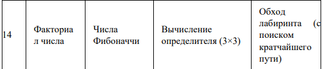
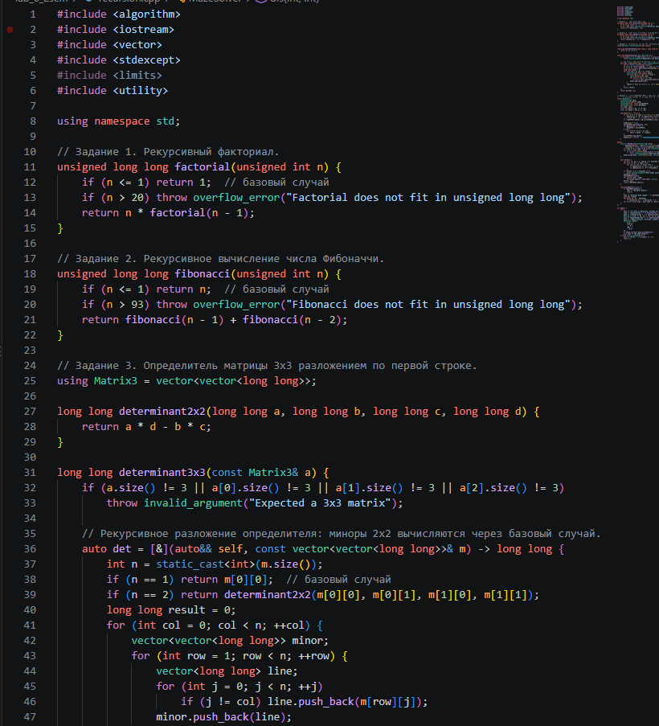
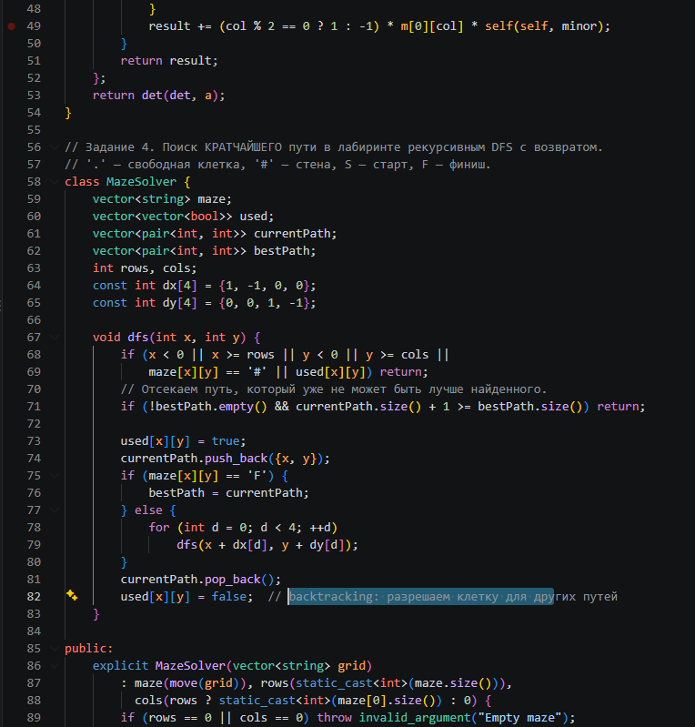
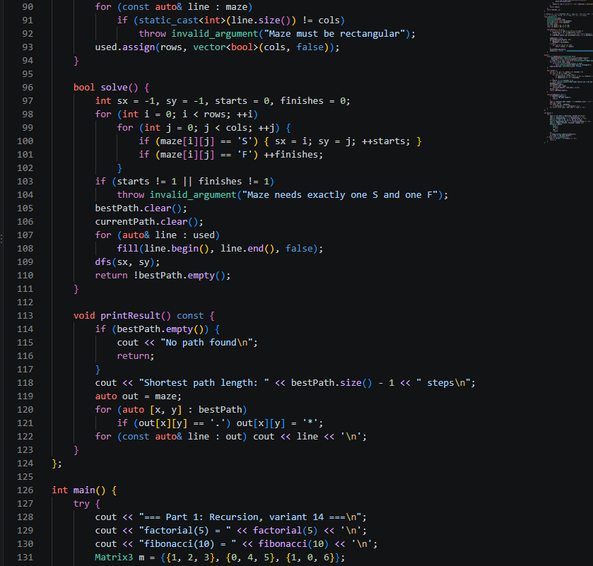
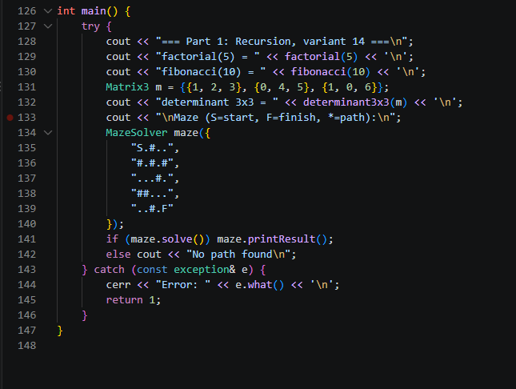
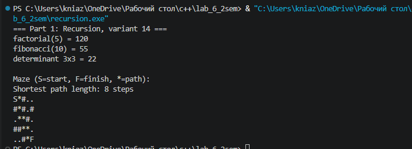
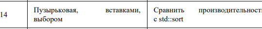
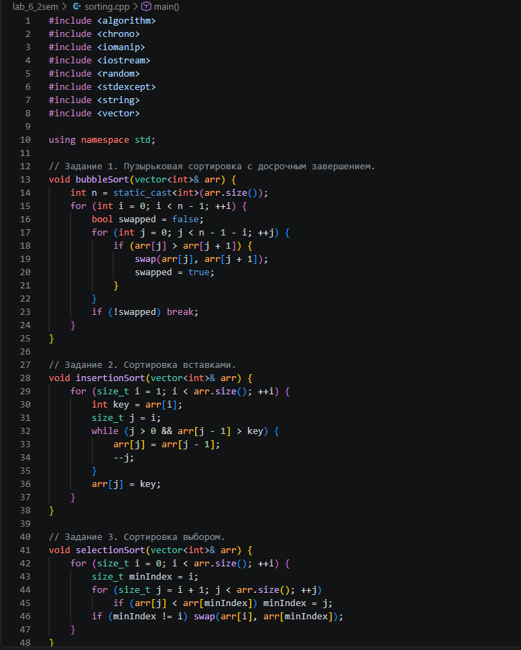
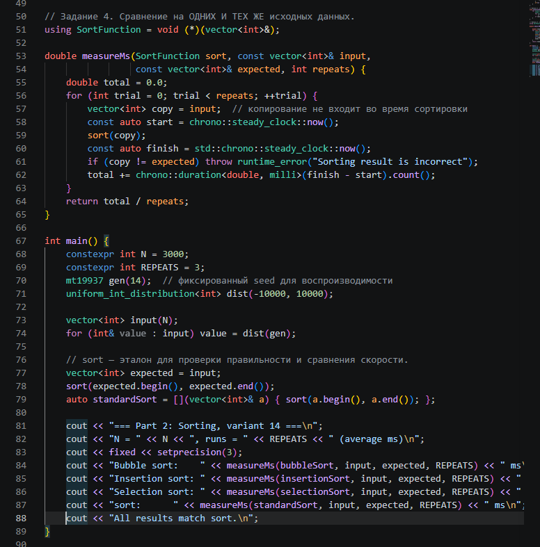
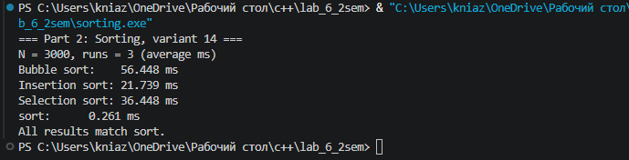

# Отчёт по лабораторной работе №6

## Рекурсивные алгоритмы. Простые сортировки

**Выполнил:** Щербинин Данил Вячеславович  
**Группа:** ПИЖ-б-о-25-2  
**Вариант:** 14  
**Год:** 2026

---

## 1. Цель работы

Освоить рекурсивные алгоритмы и простые методы сортировки. Реализовать задачи варианта 14: факториал, числа Фибоначчи, определитель матрицы 3×3 и поиск кратчайшего пути в лабиринте. Реализовать пузырьковую сортировку, сортировку вставками и выбором, сравнить их производительность со `std::sort`.

## 2. Теоретическая часть

**Рекурсия** — вызов функцией самой себя. Любой рекурсивный алгоритм должен иметь базовый случай (условие остановки) и рекурсивный шаг (переход к меньшей задаче). **Поиск с возвратом (backtracking)** перебирает возможные решения и отменяет выбор, если путь не подходит.

**Сортировка** — упорядочивание элементов. В работе рассматриваются три простых алгоритма:

| Алгоритм | Принцип | Лучший случай | Средний / худший |
|---|---|---|---|
| Пузырьковая | Обмен соседних элементов | O(n) с оптимизацией | O(n²) |
| Вставками | Вставка очередного элемента в отсортированную часть | O(n) | O(n²) |
| Выбором | Поиск минимума и перестановка | O(n²) | O(n²) |

Все три алгоритма используют O(1) дополнительной памяти. Стандартный `std::sort` обычно существенно быстрее на больших массивах; его гарантированная сложность — O(n log n).

## 3. Ход работы

### recursion.cpp

**Задание:**

**Код:**

**Терминал:**

### sorting.cpp

**Задание:**

**Код:**

**Терминал:**

## 4. Контрольные вопросы

**1. Что такое рекурсия? Из каких компонентов состоит рекурсивная функция?**  
Рекурсия — вызов функцией самой себя. Состоит из базового случая и рекурсивного шага.

**2. Что такое базовый случай рекурсии? Почему он важен?**  
Это условие завершения рекурсивных вызовов. Без него возможны бесконечная рекурсия и переполнение стека.

**3. Чем отличается прямая рекурсия от косвенной?**  
При прямой функция вызывает себя; при косвенной несколько функций вызывают друг друга по цепочке.

**4. Что такое хвостовая рекурсия? В чём её преимущество?**  
Рекурсивный вызов выполняется последним действием функции. Некоторые компиляторы могут оптимизировать такой вызов, уменьшая расход памяти.

**5. Какова временная сложность рекурсивного вычисления чисел Фибоначчи? Почему?**  
У простой реализации — экспоненциальная, O(φⁿ), поскольку одни и те же значения вычисляются многократно.

**6. Как можно оптимизировать рекурсивное вычисление Фибоначчи?**  
Использовать мемоизацию — сохранять уже вычисленные значения. Тогда время сокращается до O(n).

**7. В чём отличие рекурсивной реализации от итеративной?**  
Рекурсивная использует вызовы функций, итеративная — циклы. Рекурсия обычно требует дополнительную память для стека вызовов.

**8. Какова сложность пузырьковой сортировки? Когда она становится O(n)?**  
В среднем и худшем случае O(n²). На уже отсортированном массиве с проверкой отсутствия обменов — O(n).

**9. Чем сортировка вставками отличается от сортировки выбором?**  
Вставки помещают каждый элемент в правильную позицию отсортированной части; выбор находит минимальный элемент и меняет его местами с текущим.

**10. Какая из простых сортировок является устойчивой? Что это значит?**  
Пузырьковая сортировка и сортировка вставками обычно устойчивы: равные элементы сохраняют относительный порядок. Обычная сортировка выбором неустойчива.

**11. Какая из простых сортировок работает лучше на почти отсортированных данных?**  
Обычно сортировка вставками, поскольку требуется мало перемещений элементов.

**12. Как реализовать пузырьковую сортировку с оптимизацией?**  
Использовать флаг обменов: если за проход не произошло ни одного обмена, завершить сортировку раньше.

**13. Что такое рекурсивный поиск с возвратом (backtracking)?**  
Метод перебора решений, при котором после проверки одного выбора алгоритм возвращается назад и пробует другой.

**14. Как рекурсивно обойти лабиринт?**  
Начать со стартовой клетки, рекурсивно посещать доступных соседей, помечать клетки и возвращаться назад при тупике. Для поиска кратчайшего пути сравнивать длины найденных маршрутов.

**15. Какова сложность Ханойских башен? Сколько ходов нужно для перемещения n дисков?**  
Требуется 2ⁿ − 1 ходов, временная сложность алгоритма O(2ⁿ).

## 5. Вывод

В ходе работы реализованы четыре рекурсивные задачи варианта 14 и три простые сортировки. Проведено сравнение их сложности и времени выполнения со `std::sort`. Закреплены навыки рекурсии, поиска с возвратом и анализа алгоритмов.
