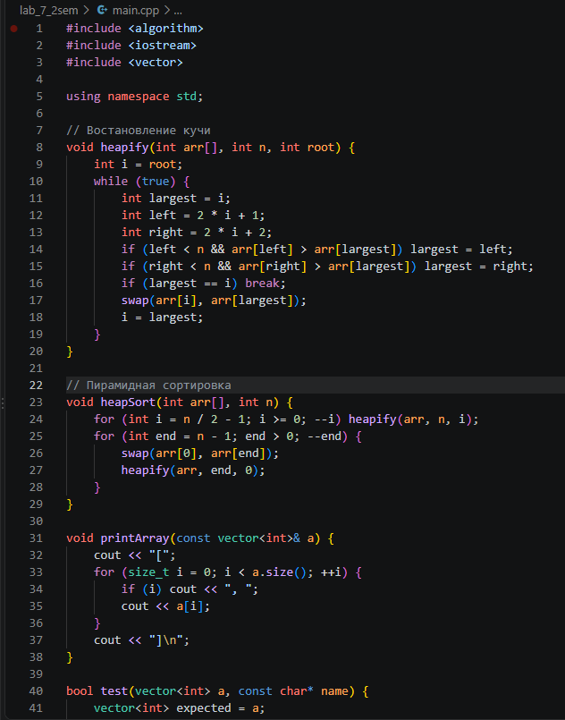
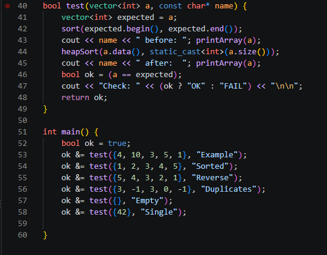
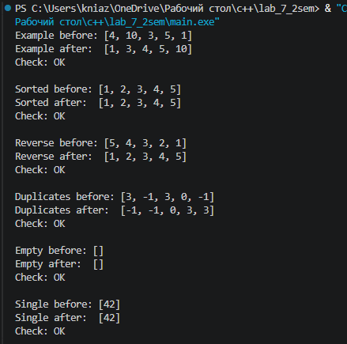

# Отчёт по лабораторной работе №7

## Быстрая сортировка, сортировка слиянием и пирамидальная сортировка

**Выполнил:** Щербинин Данил Вячеславович  
**Группа:** ПИЖ-б-о-25-2  
**Вариант:** 14  
**Год:** 2026

---

## 1. Цель работы

Изучить алгоритмы быстрой сортировки, сортировки слиянием и пирамидальной сортировки. Реализовать по варианту 14 пирамидальную сортировку на месте без рекурсии, проверить корректность её работы и оценить временную сложность.

## 2. Теоретическая часть

Пирамидальная сортировка (Heap Sort) использует **максимальную двоичную кучу** — структуру, в которой значение каждого родительского узла не меньше значений его потомков. Сначала из массива строится куча, затем максимальный элемент переносится в конец, а для оставшейся части восстанавливается свойство кучи. Процесс повторяется до полной сортировки.

В варианте 14 функция `heapify()` реализуется **итеративно**, с помощью цикла `while`, без рекурсивных вызовов. Сортировка выполняется в исходном массиве и не требует дополнительного массива.

| Алгоритм | Средняя сложность | Худшая сложность | Дополнительная память |
|---|---|---|---|
| Быстрая сортировка | O(n log n) | O(n²) | O(log n) в среднем для стека вызовов |
| Сортировка слиянием | O(n log n) | O(n log n) | O(n) |
| Пирамидальная сортировка | O(n log n) | O(n log n) | O(1) в итеративной реализации |

## 3. Ход работы

**Задание:**

**Код:**

**Терминал:**

## 4. Контрольные вопросы

**1. Какова сложность быстрой сортировки в лучшем, среднем и худшем случае?**

В лучшем и среднем случае — O(n log n), в худшем — O(n²).

**2. Когда возникает худший случай для быстрой сортировки?**

Когда опорный элемент постоянно делит массив на крайне неравные части, например на 0 и n−1 элементов.

**3. Как можно улучшить быструю сортировку для защиты от худшего случая?**

Использовать случайный опорный элемент, выбор медианы из трёх или переход на другой алгоритм при большой глубине рекурсии.

**4. Какова сложность сортировки слиянием? Почему она всегда O(n log n)?**

O(n log n): массив делится примерно пополам на O(log n) уровнях, а слияние на каждом уровне занимает O(n).

**5. Какие преимущества и недостатки имеет сортировка слиянием перед быстрой?**

Сортировка слиянием гарантирует O(n log n) и может быть устойчивой, но обычно требует O(n) дополнительной памяти. Быстрая сортировка часто экономнее по памяти и быстрее на практике, однако имеет худший случай O(n²).

**6. Как работает пирамидальная сортировка? Какова её сложность?**

Сначала строится максимальная куча. Затем её корень меняется с последним элементом, размер кучи уменьшается и свойство кучи восстанавливается. Сложность — O(n log n).

**7. Какая из трёх сортировок устойчивая? Почему?**

Сортировка слиянием может быть устойчивой: при равенстве ключей элементы из левой части выбираются первыми, поэтому исходный порядок равных элементов сохраняется. Обычные реализации быстрой и пирамидальной сортировок неустойчивы.

**8. Какая из трёх сортировок требует дополнительной памяти? Сколько?**

Сортировка слиянием обычно требует O(n). Быстрая сортировка использует стек вызовов O(log n) в среднем и до O(n) в худшем случае. Итеративная пирамидальная сортировка использует O(1).

**9. Какая из трёх сортировок лучше работает на почти отсортированных данных?**

Зависит от реализации. Быстрая сортировка с удачным выбором опорного элемента часто эффективна, но при неудачном выборе может работать за O(n²). Сортировка слиянием и пирамидальная сохраняют O(n log n).

**10. Зачем в пирамидальной сортировке сначала строится куча?**

Чтобы максимальный элемент находился в корне и его можно было быстро переместить в конец массива. После этого куча восстанавливается за O(log n).

**11. Что такое «разделяй и властвуй»? Как он применяется в быстрой сортировке и сортировке слиянием?**

Это подход, при котором задача делится на меньшие подзадачи. Быстрая сортировка разделяет элементы относительно опорного, а сортировка слиянием делит массив пополам и затем объединяет отсортированные части.

**12. Можно ли реализовать быструю сортировку итеративно (без рекурсии)?**

Да. Вместо рекурсивных вызовов можно использовать собственный стек диапазонов массива.

**13. Почему быстрая сортировка обычно быстрее сортировки слиянием на практике?**

При сортировке массивов она часто имеет хорошую локальность доступа к памяти и не требует дополнительного массива для слияния. Результат зависит от реализации и входных данных.

**14. Когда выгодно использовать пирамидальную сортировку?**

Когда важны гарантированная сложность O(n log n) и небольшой расход дополнительной памяти.

**15. Какой алгоритм сортировки вы бы выбрали для встроенных систем с ограниченной памятью?**

Пирамидальную сортировку: она работает на месте, использует O(1) дополнительной памяти и гарантирует O(n log n).

## 5. Вывод

В ходе лабораторной работы изучена пирамидальная сортировка и реализован её итеративный вариант без рекурсии. Проверена корректность сортировки на разных массивах и рассмотрена сложность O(n log n) при O(1) дополнительной памяти.
