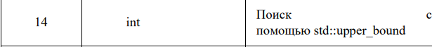
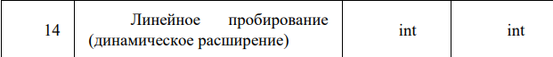
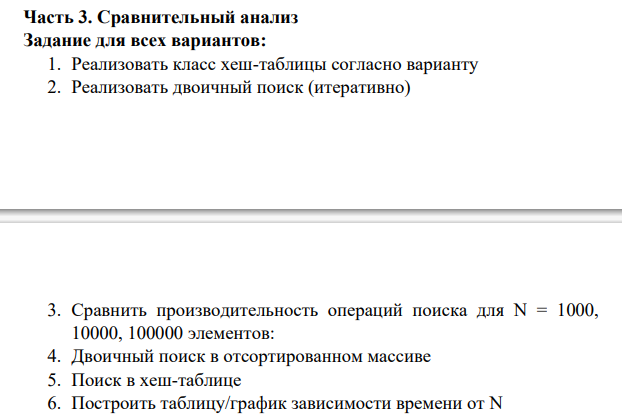
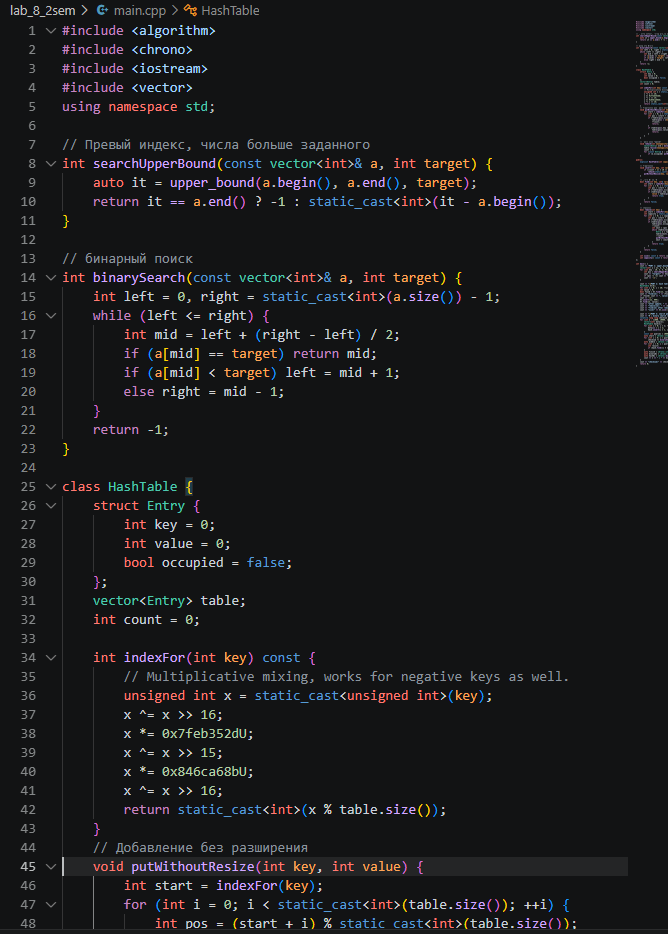
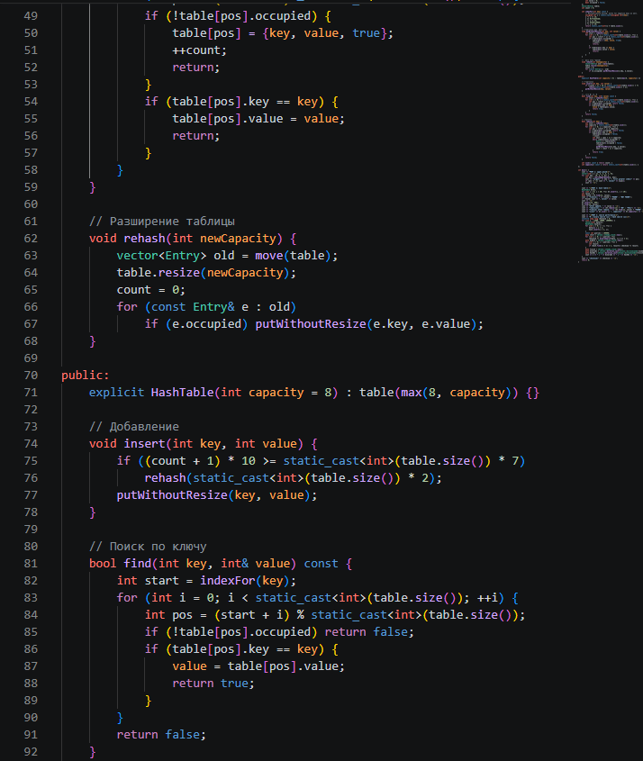
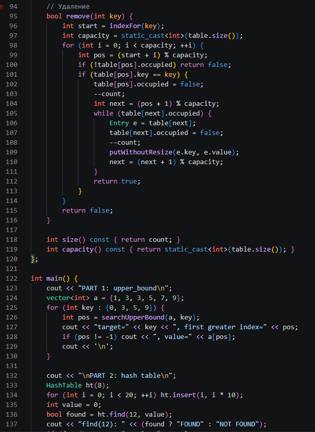
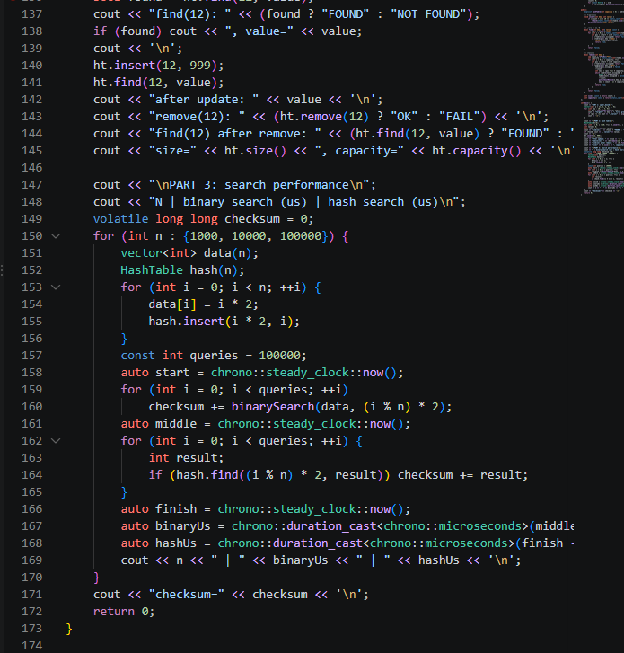
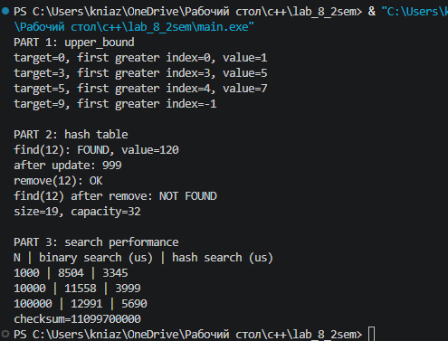

# Лабораторная работа №8

**Тема:** Двоичный поиск. Хеш-таблицы  
**Студент:** Щербинин Данил Вячеславович  
**Группа:** ПИЖ-б-о-25-2  
**Вариант:** 14  
**Год:** 2026

## 1. Цель работы

Изучить двоичный поиск и принцип работы хеш-таблиц. Реализовать поиск с помощью `upper_bound`, хеш-таблицу с линейным пробированием и динамическим расширением, проверить корректность операций и сравнить скорость поиска.

## 2. Теоретическая часть

**Двоичный поиск** применяется к отсортированному массиву. На каждом шаге область поиска делится пополам, поэтому временная сложность составляет **O(log n)**. Функция `upper_bound` возвращает позицию первого элемента, строго большего заданного значения.

**Хеш-таблица** хранит пары «ключ — значение». Хеш-функция преобразует ключ в индекс массива. Если разные ключи попадают в одну ячейку, возникает **коллизия**. При **линейном пробировании** программа последовательно проверяет следующие ячейки до нахождения свободной позиции или нужного ключа.

**Динамическое расширение (рехеширование)** выполняется при увеличении коэффициента загрузки: создаётся таблица большего размера, после чего элементы размещаются заново. Это помогает сохранить эффективность поиска.

| Алгоритм / операция | Средняя сложность | Худшая сложность |
|---|---|---|
| Двоичный поиск | O(log n) | O(log n) |
| Поиск в хеш-таблице | O(1) | O(n) |
| Вставка в хеш-таблицу | O(1) амортизированно | O(n) |
| Удаление из хеш-таблицы | O(1) в среднем | O(n) |
| Рехеширование | O(n) | O(n) |

**Задание варианта 14:** реализовать двоичный поиск для `int` с использованием `upper_bound`; хеш-таблицу `int → int` с линейным пробированием и динамическим расширением; сравнить производительность поиска для **N = 1000, 10000, 100000** элементов.

## 3. Ход работы

**Задание:**

**Код:**

**Терминал:**

## 4. Контрольные вопросы

**1. Какое условие необходимо для применения двоичного поиска?**  
Массив должен быть отсортирован в соответствии с используемым порядком сравнения.

**2. Какова сложность двоичного поиска? Почему она логарифмическая?**  
O(log n), поскольку на каждом шаге область поиска уменьшается примерно вдвое.

**3. В чём разница между итеративной и рекурсивной реализацией двоичного поиска?**  
Итеративная использует цикл и O(1) дополнительной памяти, рекурсивная — вызовы функции и O(log n) памяти стека.

**4. Чем опасен вариант `mid = (left + right) / 2`? Как правильно вычислять середину?**  
Сумма индексов может переполниться. Безопаснее использовать `mid = left + (right - left) / 2`.

**5. Что такое хеш-таблица? Из каких компонентов она состоит?**  
Это структура хранения пар «ключ — значение». Основные компоненты: массив ячеек, хеш-функция и способ разрешения коллизий.

**6. Какие требования предъявляются к хеш-функции?**  
Быстрое вычисление, детерминированность и равномерное распределение ключей.

**7. Что такое коллизия в хеш-таблице? Как с ней бороться?**  
Коллизия возникает, когда разные ключи получают один индекс. Используют метод цепочек или открытую адресацию.

**8. В чём отличие метода цепочек от открытой адресации?**  
При методе цепочек элементы с одинаковым индексом хранятся в отдельной структуре. При открытой адресации ищется другая ячейка самой таблицы.

**9. Что такое первичная и вторичная кластеризация?**  
Первичная — образование длинных последовательностей занятых ячеек при линейном пробировании. Вторичная — совпадение последовательностей пробирования для ключей с одинаковым начальным индексом, например при квадратичном пробировании.

**10. Какова средняя и худшая сложность операций в хеш-таблице?**  
В среднем O(1), в худшем случае O(n) из-за большого количества коллизий.

**11. Когда эффективнее использовать двоичный поиск, а когда — хеш-таблицу?**  
Двоичный поиск удобен для отсортированных данных и поиска по порядку. Хеш-таблица подходит для частого поиска по точному ключу.

**12. Что такое коэффициент загрузки хеш-таблицы? Почему он важен?**  
Это отношение числа элементов к количеству ячеек. При высокой загрузке увеличивается количество проб и замедляется поиск.

**13. Как работает рехеширование (динамическое расширение хеш-таблицы)?**  
Создаётся таблица большего размера, после чего для каждого элемента заново вычисляется позиция и выполняется вставка.

**14. Как выбрать размер хеш-таблицы? Почему часто выбирают простое число?**  
Размер выбирают с учётом ожидаемого количества элементов и допустимой загрузки. Простое число иногда помогает уменьшить закономерные коллизии при использовании остатка от деления.

**15. Как реализовать хеш-функцию для строк?**  
Можно последовательно обрабатывать символы, например по формуле `hash = hash * 31 + c`, а затем приводить результат к диапазону индексов таблицы.

## 5. Вывод

В ходе лабораторной работы изучены двоичный поиск и хеш-таблицы. Реализованы поиск с помощью `upper_bound`, хеш-таблица с линейным пробированием и динамическим расширением, а также проверка и сравнение операций поиска. Двоичный поиск имеет сложность O(log n), а поиск в хеш-таблице — O(1) в среднем.
