# Отчёт по лабораторной работе №5

## Стек, очередь, дек, приоритетная очередь

**Выполнил:** Щербинин Данил Вячеславович  
**Группа:** ПИЖ-б-о-25-2  
**Вариант:** 14  
**Год:** 2026

---

## 1. Цель работы

Реализовать стек, очередь, дек и приоритетную очередь на C++, изучить принципы LIFO и FIFO, освоить работу с динамической памятью и указателями. Выполнить четыре индивидуальных задания варианта 14 и проанализировать сложность основных операций.

## 2. Теоретическая часть

**Стек** работает по принципу LIFO: последним добавленный элемент извлекается первым. **Очередь** работает по принципу FIFO: первым извлекается элемент, добавленный раньше остальных. **Дек** позволяет добавлять и удалять элементы с обоих концов. **Приоритетная очередь** извлекает элементы согласно их приоритету; обычно она реализуется с помощью бинарной кучи.

| Структура | Основные операции | Сложность |
|---|---|---|
| Стек | `push`, `pop`, `top` | O(1) амортизированно для `push`, O(1) для остальных |
| Очередь | `enqueue`, `dequeue`, `front` | O(1) |
| Дек | `push_front`, `push_back`, `pop_front`, `pop_back` | O(1) |
| Приоритетная очередь | `push`, `pop`, `top` | O(log n), O(log n), O(1) |

В программе используются собственные реализации структур данных. Динамическая память освобождается в деструкторах, а попытки извлечь элементы из пустой структуры обрабатываются исключениями.

## 3. Ход работы

**Задание:**

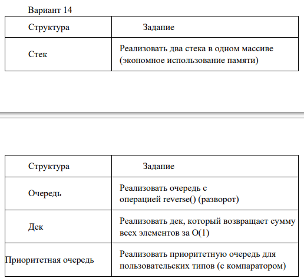

**Код:**

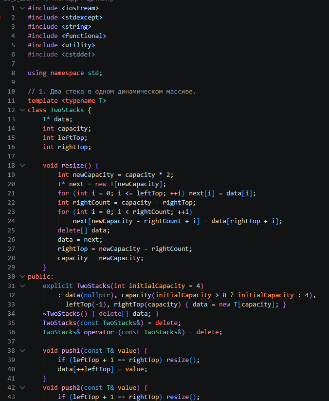

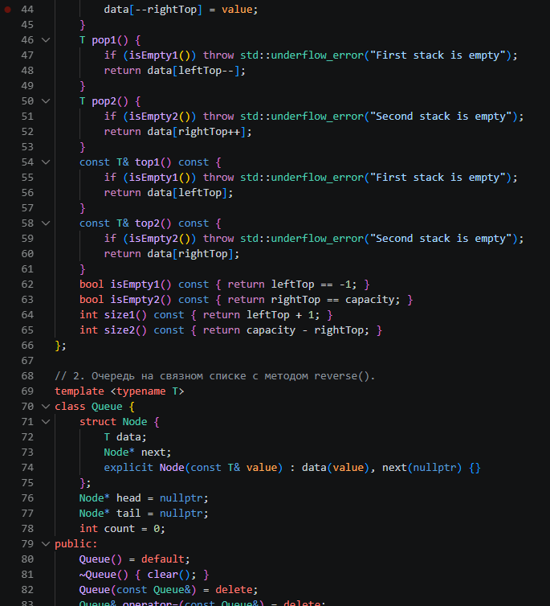

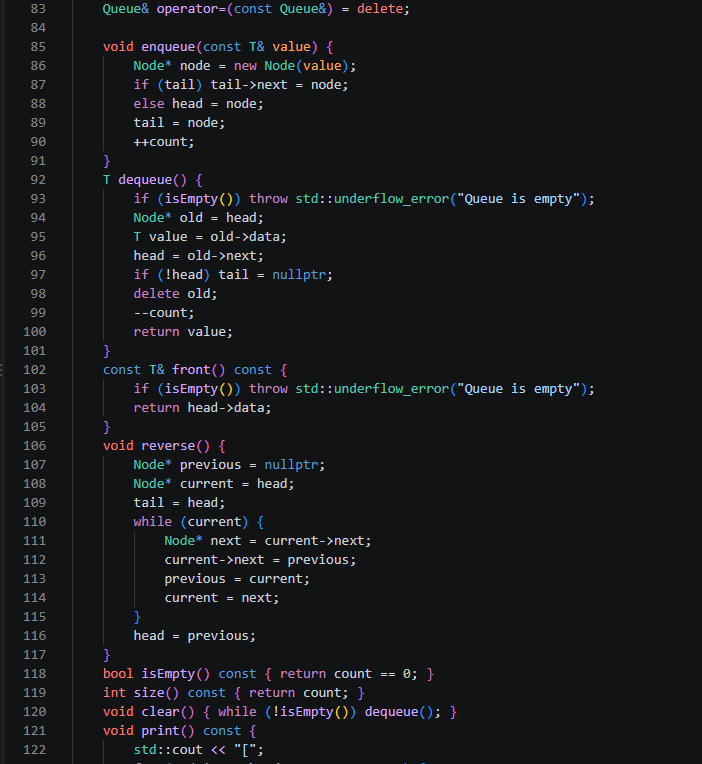

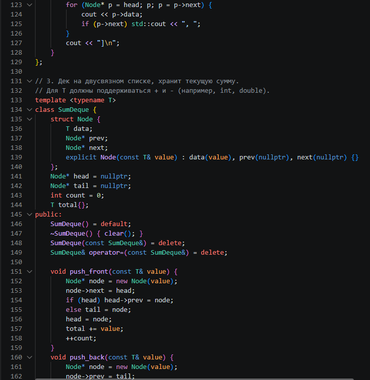

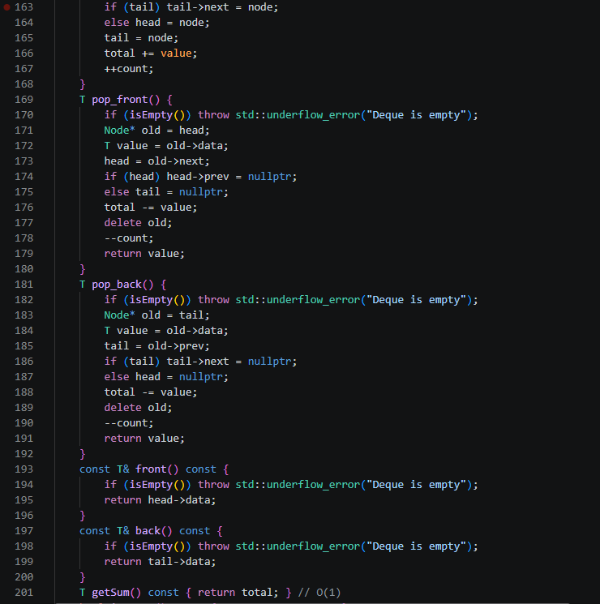

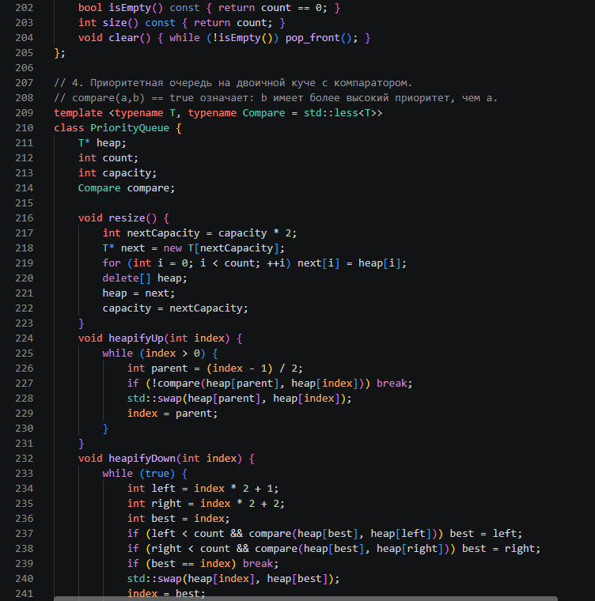

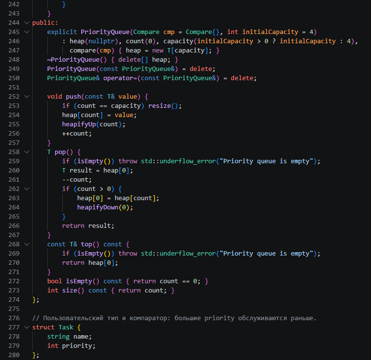

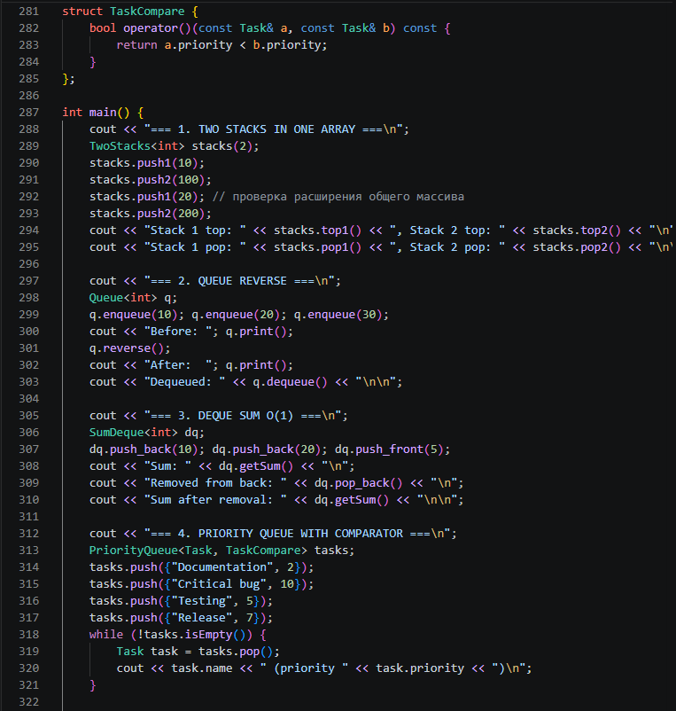

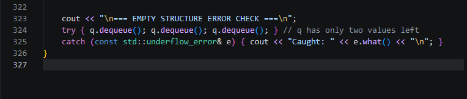

**Результат:**

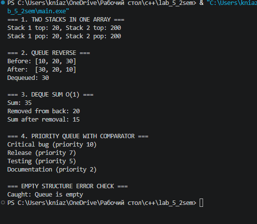

## 4. Контрольные вопросы

**1. В чём заключается принцип работы стека (LIFO)?**

LIFO означает «последним пришёл — первым ушёл». Последний добавленный элемент извлекается первым.

**2. В чём заключается принцип работы очереди (FIFO)?**

FIFO означает «первым пришёл — первым ушёл». Элементы извлекаются в порядке добавления.

**3. Чем дек отличается от обычной очереди?**

Дек позволяет добавлять и удалять элементы с обоих концов, а обычная очередь добавляет в конец и удаляет из начала.

**4. Что такое приоритетная очередь? Где она применяется?**

Это структура, в которой первым извлекается элемент с наивысшим приоритетом. Используется, например, в планировщиках задач и алгоритмах поиска кратчайшего пути.

**5. Как реализовать стек на основе динамического массива?**

Хранить элементы в массиве и индекс вершины. `push` добавляет значение на вершину, `pop` удаляет его, а при заполнении массива память расширяется.

**6. Как реализовать очередь на основе кольцевого буфера?**

Использовать массив и индексы начала и конца. После достижения конца массива индексы переходят в начало по модулю ёмкости.

**7. Почему приоритетную очередь обычно реализуют на куче?**

Бинарная куча позволяет получать максимальный или минимальный по приоритету элемент за O(1), а добавлять и удалять — за O(log n).

**8. Какова сложность операций push и pop в стеке?**

Обычно O(1). При использовании расширяемого массива `push` имеет амортизированную сложность O(1), но отдельное расширение занимает O(n).

**9. Какова сложность операций enqueue и dequeue в очереди?**

Обе операции выполняются за O(1), если очередь реализована на связном списке с указателями `head` и `tail` или на кольцевом буфере достаточной ёмкости.

**10. Какова сложность операций в приоритетной очереди? Почему?**

`push` и `pop` выполняются за O(log n), так как элемент перемещается по высоте бинарной кучи. `top` выполняется за O(1), поскольку нужный элемент находится в корне.

**11. Как проверить правильность расстановки скобок с помощью стека?**

Открывающие скобки помещают в стек. Для каждой закрывающей извлекают верхнюю открывающую и проверяют соответствие. В конце стек должен быть пустым.

**12. Как реализовать очередь на двух стеках? Какова сложность?**

Один стек используют для добавления, другой — для извлечения. Когда второй пуст, в него перекладывают элементы из первого. Операции имеют амортизированную сложность O(1).

**13. Как реализовать дек на основе двусвязного списка?**

Хранить указатели `head` и `tail`, а в каждом узле — `prev` и `next`. Это позволяет добавлять и удалять элементы с обоих концов за O(1).

**14. Как реализовать дек на основе кольцевого буфера?**

Использовать массив, начальный индекс и количество элементов. При вставке и удалении с любого конца индексы изменяются циклически по модулю ёмкости.

**15. Как реализовать стек с поддержкой получения минимума за O(1)?**

Использовать дополнительный стек, который на каждом уровне хранит текущий минимум. Тогда минимальное значение всегда доступно на его вершине за O(1).

## 5. Вывод

В ходе лабораторной работы реализованы четыре структуры данных: два стека в одном массиве, очередь с разворотом, дек с вычислением суммы за O(1) и приоритетная очередь с компаратором. Закреплены навыки работы с динамической памятью, указателями и бинарной кучей. Проведён анализ сложности основных операций.
