# Лабораторная работа №9

**Тема:** Бинарное дерево. Обходы. BST  
**Студент:** Щербинин Данил Вячеславович  
**Группа:** ПИЖ-б-о-25-2  
**Вариант:** 14  
**Год:** 2026

## 1. Цель работы

Изучить бинарные деревья и способы их обхода, реализовать бинарное дерево поиска (BST), освоить вставку, поиск, удаление и объединение деревьев, а также проанализировать сложность операций.

## 2. Теоретическая часть

**Бинарное дерево** — структура данных, в которой каждый узел имеет не более двух потомков: левого и правого. Узел без потомков называется листом.

Основные виды обхода:

- **Прямой (preOrder):** корень → левое поддерево → правое поддерево.
- **Симметричный (inOrder):** левое поддерево → корень → правое поддерево.
- **Обратный (postOrder):** левое поддерево → правое поддерево → корень.
- **Уровневый (levelOrder):** узлы просматриваются по уровням с использованием очереди.

**Бинарное дерево поиска (BST)** — дерево, в котором ключи левого поддерева меньше ключа узла, а ключи правого — больше. Симметричный обход BST выводит значения по возрастанию.

**Диаметр дерева** — максимальное расстояние между двумя узлами. В программе он измеряется количеством рёбер и вычисляется через высоты поддеревьев.

При удалении узла BST рассматриваются три случая: узел без потомков, узел с одним потомком и узел с двумя потомками. В последнем случае используется минимальный элемент правого поддерева.

### Задание по варианту 14

1. Реализовать четыре обхода бинарного дерева и вычислить его диаметр.
2. Реализовать BST с операциями `insert`, `search`, `inOrder`, `remove` и объединением двух BST.
3. Создать BST из 20 случайных чисел, вывести отсортированную последовательность, найти минимум, максимум, высоту и удалить введённый пользователем элемент.

### Анализ сложности

| Операция | Временная сложность |
|---|---|
| Обход дерева | O(n) |
| Вычисление диаметра | O(n) |
| Поиск в BST | O(h), в среднем O(log n), в худшем O(n) |
| Вставка в BST | O(h), в среднем O(log n), в худшем O(n) |
| Удаление из BST | O(h), в среднем O(log n), в худшем O(n) |
| Поиск минимума и максимума | O(h) |
| Вычисление высоты | O(n) |
| Объединение двух BST | O(m · h), где m — число узлов второго дерева, h — высота первого в процессе вставок |

Здесь `n` — количество узлов, `h` — высота дерева. Дополнительная память рекурсивных алгоритмов зависит от высоты дерева: O(h). Уровневый обход использует очередь до O(n) элементов.

## 3. Ход работы

### Часть 1

**Задание:**

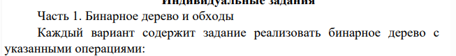

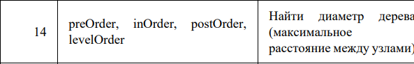

**Код:**

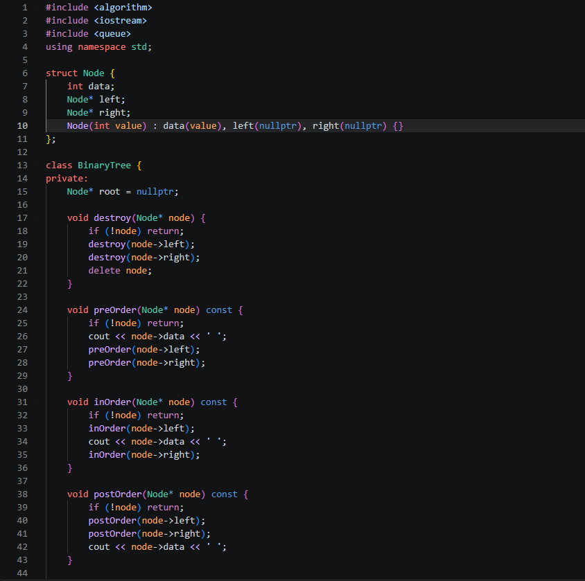

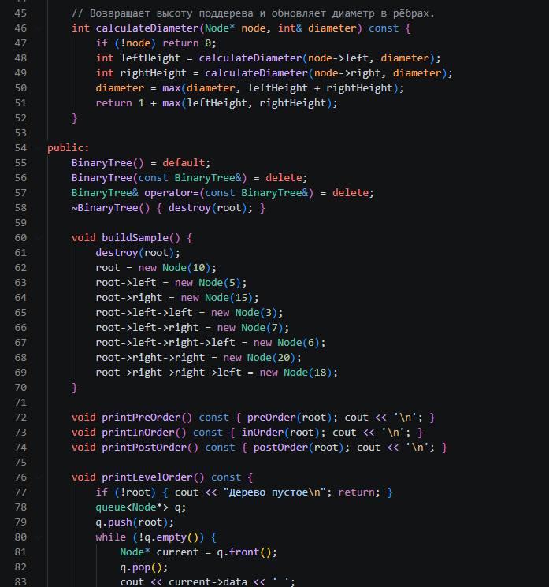

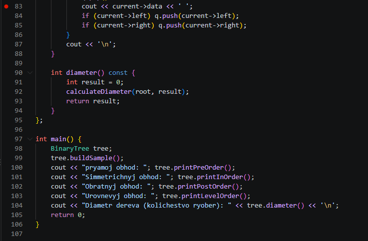

**Терминал:**

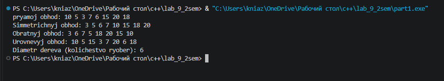

### Часть 2

**Задание:**

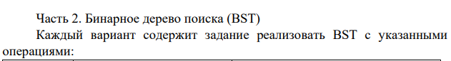

**Код:**

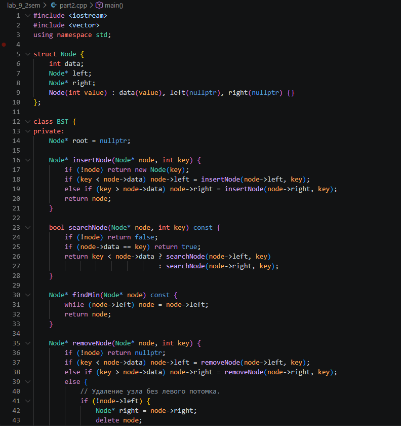

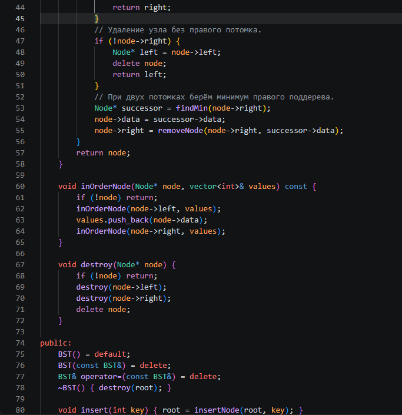

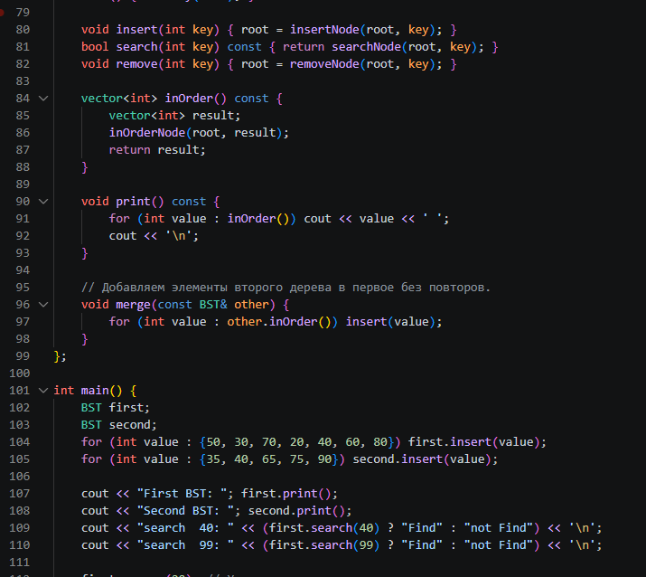

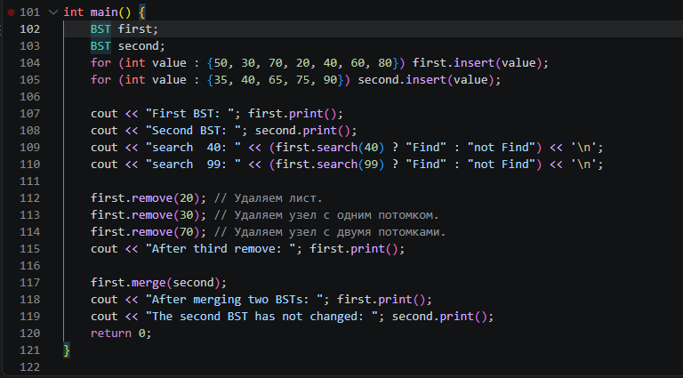

**Терминал:**

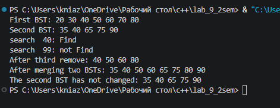

### Часть 3

**Задание:**

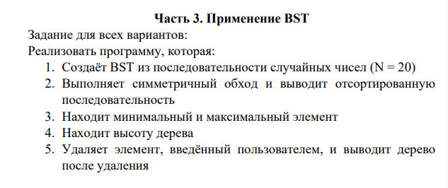

**Код:**

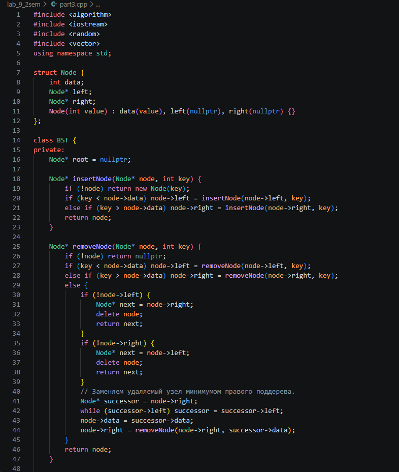

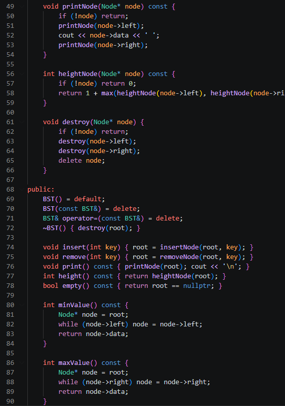

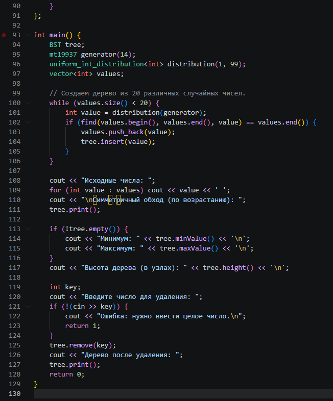

**Терминал:**

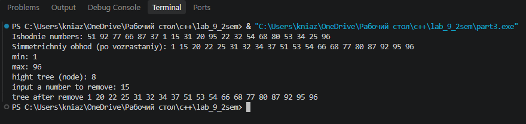

## 4. Контрольные вопросы

**1. Что такое бинарное дерево? Из каких элементов оно состоит?**  
Бинарное дерево — иерархическая структура из узлов, каждый из которых имеет не более двух потомков. Состоит из корня, внутренних узлов и листьев.

**2. В чём отличие бинарного дерева от бинарного дерева поиска (BST)?**  
В BST все значения слева от узла меньше его значения, а справа — больше. Обычное бинарное дерево такого ограничения не имеет.

**3. Какие существуют виды обхода бинарного дерева? В чём их особенности?**  
Прямой — корень, левое, правое; симметричный — левое, корень, правое; обратный — левое, правое, корень; уровневый — просмотр узлов по уровням.

**4. Какой обход даёт отсортированную последовательность для BST?**  
Симметричный обход (`inOrder`).

**5. Какова сложность операций поиска, вставки и удаления в BST? От чего она зависит?**  
O(h), где h — высота дерева: в среднем O(log n), в худшем случае O(n).

**6. Что происходит с BST, если вставлять элементы в отсортированном порядке?**  
Обычное BST может выродиться в цепочку, и операции замедлятся до O(n).

**7. Какие три случая нужно рассмотреть при удалении узла из BST?**  
Удаление листа, узла с одним потомком и узла с двумя потомками.

**8. Как найти наименьший элемент в BST? Наибольший?**  
Для минимума идти по левым потомкам до конца, для максимума — по правым.

**9. Как вычислить высоту бинарного дерева рекурсивно?**  
Высота пустого дерева равна 0; иначе `1 + max(высота левого, высота правого)`.

**10. Что такое наименьший общий предок (LCA) двух узлов в дереве?**  
Самый глубокий узел, являющийся предком обоих заданных узлов.

**11. Как проверить, является ли бинарное дерево BST?**  
Рекурсивно проверять, что значения каждого узла находятся в допустимом диапазоне, заданном его предками.

**12. Что такое сбалансированное дерево? Почему это важно для производительности?**  
Дерево, у которого высота поддерживается близкой к O(log n). Это позволяет быстро выполнять поиск, вставку и удаление.

**13. Как преобразовать несбалансированное BST в сбалансированное?**  
Получить отсортированный массив симметричным обходом и рекурсивно построить дерево, выбирая средний элемент корнем каждого поддерева.

**14. Как восстановить дерево по массиву обхода (in-order + pre-order)?**  
Первый элемент `preOrder` — корень. В `inOrder` элементы слева и справа от него относятся к соответствующим поддеревьям; процесс повторяется рекурсивно. Для однозначного восстановления значения должны быть различными.

**15. Как реализовать итеративный (не рекурсивный) обход бинарного дерева?**  
Для обходов в глубину использовать стек, а для уровневого обхода — очередь.

## 5. Вывод

В ходе работы реализованы бинарное дерево с четырьмя обходами и вычислением диаметра, BST с основными операциями и объединением двух деревьев. Изучено влияние высоты дерева на скорость поиска, вставки и удаления.
