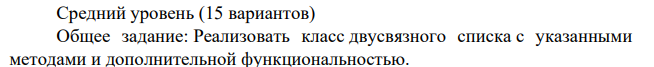
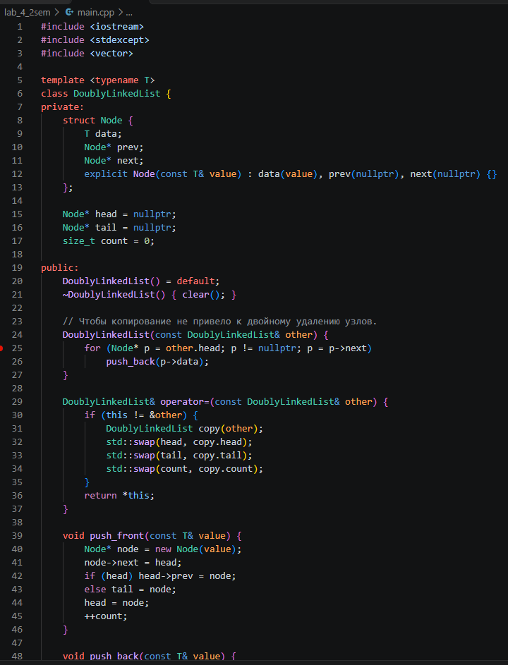
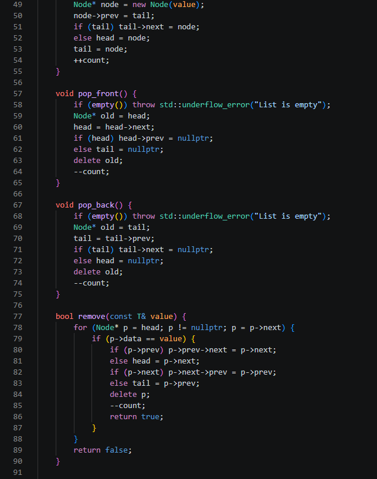
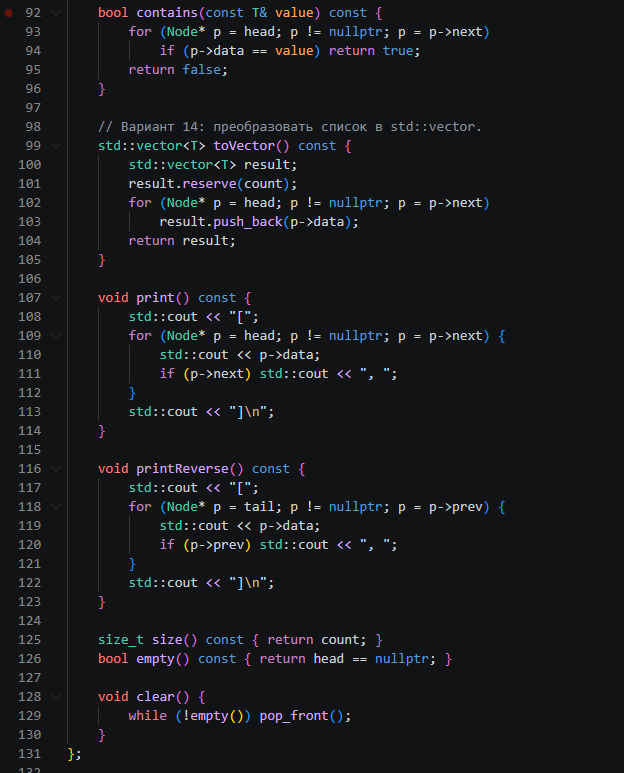
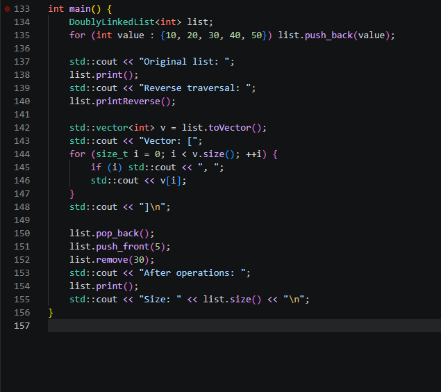
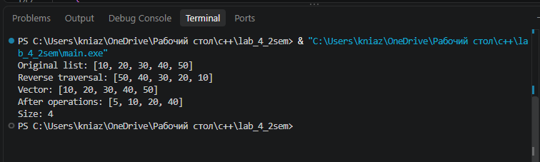

# Отчёт по лабораторной работе №4

## Односвязный и двусвязный списки

**Выполнил:** Щербинин Данил Вячеславович  
**Группа:** ПИЖ-б-о-25-2  
**Вариант:** 14  
**Уровень:** Средний  
**Год:** 2026

---

## 1. Цель работы

Реализовать шаблонный класс двусвязного списка `DoublyLinkedList<T>` с операциями добавления, удаления, поиска и обхода элементов. Изучить работу с указателями и динамической памятью. По варианту 14 реализовать метод `toVector()` для преобразования списка в `std::vector` и проанализировать сложность операций.

## 2. Теоретическая часть

Связный список — структура данных, состоящая из узлов, соединённых указателями. В **односвязном** списке узел хранит указатель `next` на следующий элемент, а в **двусвязном** — указатели `prev` и `next` на предыдущий и следующий элементы.

В классе `DoublyLinkedList<T>` используются:

- `head` — указатель на первый узел;
- `tail` — указатель на последний узел;
- `count` — количество элементов.

В отличие от массива, список не обеспечивает быстрый доступ по индексу, зато позволяет добавлять и удалять элементы на концах за `O(1)` при наличии указателей `head` и `tail`. Узлы создаются с помощью `new` и освобождаются через `delete`.

## 3. Ход работы

**Задание:**

**Код:**

**Результат:**

## 4. Контрольные вопросы

**1. Чем связный список отличается от динамического массива?**

В массиве элементы располагаются последовательно в памяти и доступны по индексу за `O(1)`. В списке элементы связаны указателями, поэтому доступ по индексу требует `O(n)`.

**2. Какие операции в односвязном списке выполняются за O(1)?**

Добавление и удаление из начала; добавление в конец при наличии `tail`; проверка на пустоту и получение сохранённого размера.

**3. Почему удаление из конца односвязного списка требует O(n) времени?**

Нужно найти предпоследний узел, пройдя список от начала, чтобы изменить его `next`.

**4. Какие преимущества даёт хранение указателя tail в односвязном списке?**

Он позволяет добавлять элементы в конец за `O(1)` без обхода списка.

**5. Чем двусвязный список отличается от односвязного?**

У двусвязного списка каждый узел имеет два указателя — `prev` и `next`, поэтому возможен обход в обе стороны.

**6. Какие операции в двусвязном списке выполняются быстрее, чем в односвязном?**

Удаление последнего элемента за `O(1)` вместо `O(n)`. Также проще удалить известный узел, используя `prev`.

**7. Что такое «голова» (head) и «хвост» (tail) списка?**

`head` указывает на первый узел, `tail` — на последний. В пустом списке оба равны `nullptr`.

**8. Как удалить узел из середины односвязного списка?**

Найти предыдущий узел, перенаправить его `next` на следующий после удаляемого и освободить память через `delete`.

**9. Как удалить узел из середины двусвязного списка? Почему это проще?**

Связать соседние узлы через `prev->next` и `next->prev`, затем удалить узел. Указатель `prev` позволяет не искать предыдущий узел.

**10. Что произойдёт, если забыть обновить tail при удалении?**

`tail` может указывать на освобождённую память, что приведёт к ошибкам и неопределённому поведению.

**11. Как реализовать реверс односвязного списка?**

Последовательно изменить направления указателей `next` с помощью трёх указателей: `prev`, `current`, `next`. Сложность — `O(n)`.

**12. Как обнаружить цикл в связном списке?**

Алгоритмом Флойда: один указатель движется на один узел, другой — на два. Если они встретились, цикл существует.

**13. В каких случаях стоит использовать список вместо массива?**

Когда нужны частые вставки и удаления элементов, а быстрый доступ по индексу не требуется.

**14. Какая дополнительная память требуется для каждого узла списка?**

В односвязном — один указатель `next`, в двусвязном — два: `prev` и `next`.

**15. Почему доступ по индексу в списке имеет сложность O(n)?**

Нужный элемент нельзя получить по адресу напрямую: необходимо последовательно пройти по указателям до него.

## 5. Вывод

В ходе лабораторной работы реализован шаблонный двусвязный список с основными операциями. По варианту 14 создан метод `toVector()`, который копирует элементы списка в `std::vector` за `O(n)`. Закреплены навыки работы с указателями, динамической памятью и анализа сложности алгоритмов.
