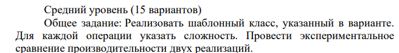
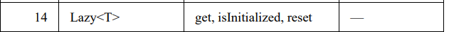
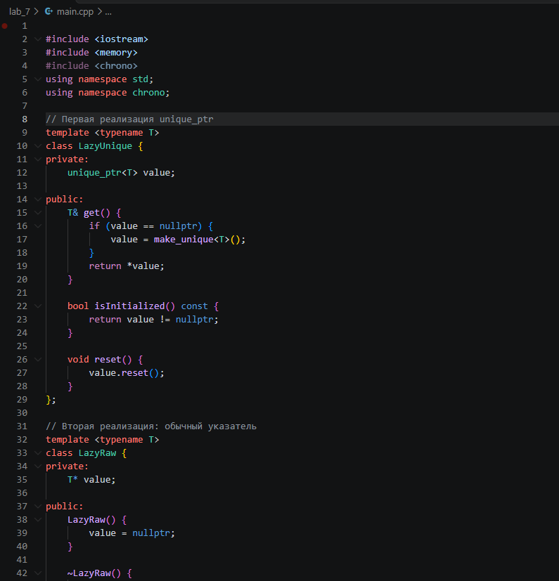
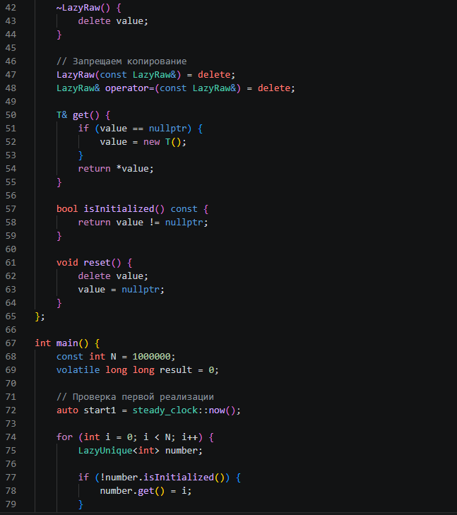
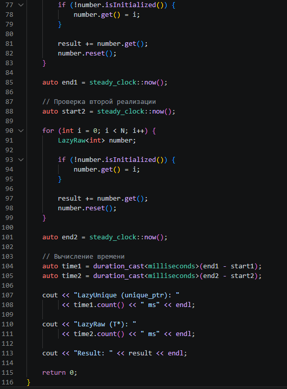
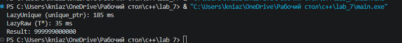

# Отчёт по лабораторной работе №2

## Анализ сложности алгоритмов. Шаблоны классов

**Выполнил:** Щербинин Данил Вячеславович  
**Группа:** ПИЖ-б-о-25-2  
**Вариант:** 14  
**Год:** 2026

---

## 1. Цель работы

Изучить основные принципы анализа сложности алгоритмов с использованием О-нотации (Big O), освоить работу с шаблонами классов C++, научиться оценивать временную и пространственную сложность операций, а также провести экспериментальное сравнение производительности двух реализаций одной задачи.

## 2. Теоретическая часть

Анализ сложности алгоритмов — это способ оценки эффективности программы в зависимости от объёма входных данных.

Существуют два основных вида сложности:

- **Временная сложность (Time Complexity)** — показывает, как изменяется время выполнения алгоритма при увеличении количества входных данных.
- **Пространственная сложность (Space Complexity)** — показывает, сколько дополнительной памяти требуется алгоритму для выполнения.

### 2.2. О-нотация (Big O)

О-нотация — математический способ описания скорости роста времени выполнения алгоритма относительно размера входных данных.

Она позволяет оценивать эффективность алгоритмов, не учитывая постоянные коэффициенты и менее значимые слагаемые.

Основные примеры:

| Сложность | Название | Пример |
|---|---|---|
| O(1) | Константная | Доступ к элементу массива по индексу |
| O(log n) | Логарифмическая | Бинарный поиск |
| O(n) | Линейная | Линейный поиск |
| O(n log n) | Линейно-логарифмическая | Сортировка слиянием |
| O(n²) | Квадратичная | Сортировка пузырьком |
| O(2ⁿ) | Экспоненциальная | Рекурсивное вычисление чисел Фибоначчи |

## 3. Ход работы

**Задание:**

**Вариант:**

**Код:**

**Результат:**

---

## 4. Анализ сложности операций

Для реализованного класса `Lazy<T>` можно выделить следующие операции:

| Операция | Временная сложность | Пространственная сложность | Обоснование |
|---|---|---|---|
| `get()` | O(1)* | O(1) | Проверка указателя и получение значения |
| `isInitialized()` | O(1) | O(1) | Проверка состояния указателя |
| `reset()` | O(1)* | O(1) | Освобождение одного объекта и сброс указателя |

\* В таблице предполагается, что создание, уничтожение и стандартные операции с объектом `T` занимают O(1). Если конструктор или деструктор типа `T` выполняет операции, зависящие от размера данных, их сложность также повлияет на время выполнения `get()` и `reset()`.

Сам класс `Lazy<T>` хранит один указатель, поэтому его собственная дополнительная память составляет O(1). Создаваемый объект `T` занимает дополнительную память, размер которой зависит от самого типа.

## 5. Ответы на контрольные вопросы

**1. Что такое О-нотация (Big O) и зачем она нужна?**

О-нотация — способ описания скорости роста времени выполнения алгоритма при увеличении объёма входных данных. Она нужна для сравнения алгоритмов и оценки их эффективности независимо от конкретного компьютера.

**2. Какая сложность у доступа к элементу массива по индексу? Почему?**

Сложность составляет O(1). Адрес элемента вычисляется напрямую по индексу, поэтому количество операций не зависит от размера массива.

**3. Какая сложность у бинарного поиска? Почему?**

Сложность составляет O(log n). На каждом шаге область поиска уменьшается примерно в два раза, поэтому количество шагов растёт логарифмически.

**4. Что означает сложность O(n log n)? Приведите пример алгоритма.**

Это линейно-логарифмическая сложность. Она часто встречается в эффективных алгоритмах сортировки. Например, сортировка слиянием имеет сложность O(n log n).

**5. Что такое амортизированный анализ? Приведите пример.**

Амортизированный анализ оценивает среднюю стоимость операции при выполнении последовательности операций. Например, добавление элемента в динамический массив обычно занимает O(1), но при расширении массива требуется O(n). Несмотря на это, средняя стоимость добавления остаётся O(1) амортизированно.

**6. Какая сложность у двух вложенных циклов по n итераций каждый?**

Сложность составляет O(n²). Внешний цикл выполняется n раз, а внутренний для каждой итерации также выполняется n раз. В результате получается n × n операций.

**7. Какая сложность у рекурсивного вычисления чисел Фибоначчи?**

При обычной рекурсивной реализации без сохранения промежуточных результатов временная сложность составляет O(2ⁿ). Это связано с повторным вычислением одних и тех же значений.

**8. Что такое шаблоны функций? Как их объявить и использовать?**

Шаблоны функций позволяют создавать функции, работающие с разными типами данных. Для объявления используется `template <typename T>`, после чего указывается обычное определение функции. Компилятор создаёт необходимую версию функции при использовании с конкретным типом.

**9. Что такое шаблоны классов? Как их объявить и использовать?**

Шаблоны классов позволяют создавать универсальные классы, которые могут хранить и обрабатывать данные разных типов. Для объявления используется `template <typename T>`, а при создании объекта указывается конкретный тип, например `Lazy<int>`.

**10. В чём преимущество шаблонов перед перегрузкой функций?**

Шаблоны позволяют использовать одну реализацию для множества типов данных. При перегрузке пришлось бы создавать отдельную функцию для каждого типа, что увеличивает объём кода и усложняет его поддержку.

**11. Как указать, что шаблонный параметр — тип?**

Для этого используется ключевое слово `typename` или `class`. Например: `template <typename T>`.

**12. Можно ли создать шаблон с несколькими параметрами типов?**

Да. Например, `template <typename T1, typename T2>`. Это позволяет создавать классы и функции, которые работают с несколькими типами данных одновременно.

**13. Как провести экспериментальное измерение времени выполнения?**

Для этого можно использовать библиотеку `<chrono>`. Необходимо зафиксировать время до выполнения операции, выполнить программу, а затем зафиксировать время после неё. Разница между двумя значениями покажет время выполнения.

**14. Почему при измерении времени нужно выполнять операцию многократно?**

Одно выполнение может занять слишком мало времени для точного измерения. Многократное выполнение позволяет получить более заметный результат и уменьшить влияние случайных факторов.

**15. Что важнее: сложность алгоритма или константа?**

Оба показателя важны. Сложность определяет, как растёт время выполнения при увеличении объёма данных, а константа влияет на фактическую скорость работы. Для больших объёмов данных обычно важнее асимптотическая сложность, но для небольших задач константы тоже могут иметь значение.

---

## 6. Вывод

В ходе лабораторной работы были изучены основы анализа сложности алгоритмов с использованием О-нотации. Были рассмотрены основные классы сложности и способы оценки временной и пространственной сложности программ.

Был реализован шаблонный класс `Lazy<T>`, обеспечивающий отложенную инициализацию объекта. С помощью методов `get()`, `isInitialized()` и `reset()` была продемонстрирована работа с объектом, который создаётся только при первом обращении.

Также были рассмотрены две реализации управления памятью: с использованием `unique_ptr` и обычного указателя. Проведён эксперимент по сравнению их производительности.

В результате работы получены навыки создания шаблонных классов, анализа сложности операций и экспериментального измерения времени выполнения программ.

