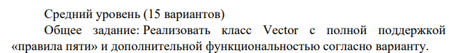
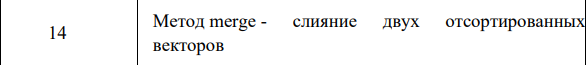
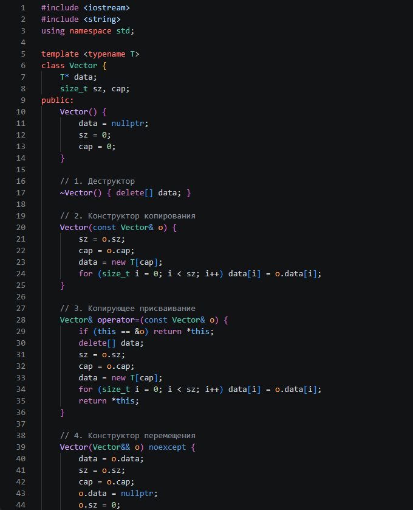
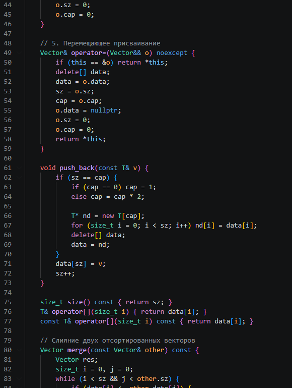
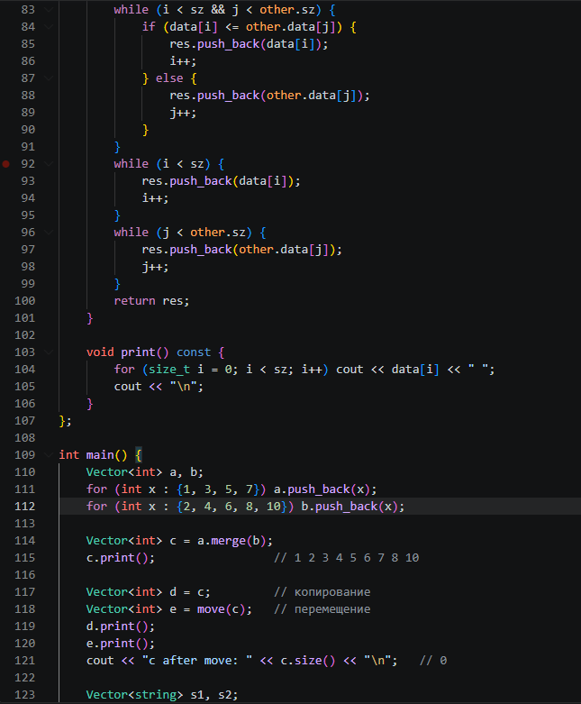
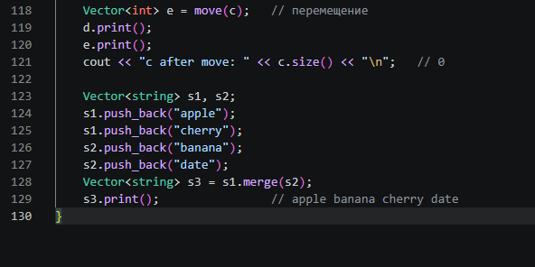
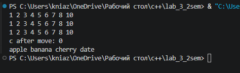

# Отчёт по лабораторной работе №3

## Реализация динамического массива (аналог vector). Итераторы

**Выполнил:** Щербинин Данил Вячеславович  
**Группа:** ПИЖ-б-о-25-2  
**Вариант:** 14  
**Год:** 2026

---

## 1. Цель работы

Цель работы: реализовать шаблонный класс `Vector<T>` — аналог `std::vector` — без использования стандартных контейнеров, освоить управление динамической памятью (выделение, расширение и освобождение), закрепить «правило трёх» (деструктор, конструктор копирования, оператор присваивания копированием) и освоить «правило пяти» (конструктор перемещения и оператор присваивания перемещением), реализовать дополнительную функциональность по варианту — метод `merge` для слияния двух отсортированных векторов, а также выполнить анализ сложности операций и провести амортизированный анализ `push_back`.

## 2. Теоретическая часть

Динамический массив — структура данных, которая хранит элементы в непрерывной области памяти, но, в отличие от статического массива, может изменять размер во время работы программы.

| Характеристика | Статический массив | Динамический массив (vector) |
|---|---|---|
| Размер | Фиксированный (известен при компиляции) | Изменяемый (определяется во время выполнения) |
| Память | Стек (ограничен) | Куча (heap) |
| Расширение | Невозможно | Автоматическое при переполнении |
| Вставка в конец | Невозможна при заполнении | O(1) амортизированно |

В классе хранятся три поля:

- `T* data` — указатель на выделенный массив;
- `int sz` — размер (количество элементов, реально лежащих в векторе);
- `int cap` — ёмкость (сколько элементов поместится без перевыделения памяти).

Если класс сам владеет ресурсом (здесь — динамической памятью), компилятор по умолчанию копирует только указатель («поверхностное копирование»), и два объекта начинают указывать на одну память. Это приводит к двойному освобождению. Поэтому нужно определить:

| Правило | Что входит |
|---|---|
| Правило трёх | Деструктор, конструктор копирования, оператор присваивания копированием |
| Правило пяти | То же + конструктор перемещения и оператор присваивания перемещением |

- **Копирование** создаёт новый массив и копирует в него элементы («глубокое копирование»).
- **Перемещение** забирает указатель у временного объекта, а у него самого ставит `nullptr`. Элементы не копируются, операция занимает O(1).
- В операторах присваивания нужна проверка `this == &other`, чтобы `a = a` не удалил собственные данные.

## 3. Ход работы

**Задание:**

**Вариант:**

**Код:**

**Результат:**

## 4. Контрольные вопросы

**1. Почему динамический массив называется «динамическим»?**

Потому что его размер не фиксирован и определяется во время выполнения программы. Память выделяется в куче (`new[]`) и при необходимости перевыделяется, когда массив заполнился.

**2. Что такое ёмкость (capacity) и чем она отличается от размера (size)?**

Размер — это количество элементов, которые сейчас хранятся в векторе. Ёмкость — это объём выделенной памяти в элементах, то есть сколько элементов можно добавить без перевыделения. Всегда выполняется `size <= capacity`.

**3. Почему при расширении массива ёмкость удваивается, а не увеличивается на фиксированное число?**

Если увеличивать на фиксированное число `k`, то расширения происходят каждые `k` вставок, и каждое копирует всё накопленное. Суммарная стоимость n вставок получается O(n²), то есть O(n) амортизированно на вставку. При удвоении расширения происходят всё реже, суммарное число копирований около 2n, и вставка стоит O(1) амортизированно.

**4. Какова амортизированная сложность операции push_back? Почему?**

O(1). Дорогие вставки с копированием (O(n)) происходят только при ёмкостях 1, 2, 4, 8, … и их суммарная стоимость меньше 2n. Распределённая по n вставкам, она даёт константу на одну операцию.

**5. Что такое «правило трёх»? Когда оно применяется?**

Если классу нужен собственный деструктор, конструктор копирования или оператор присваивания копированием, то, как правило, нужны все три. Применяется, когда класс владеет ресурсом, например динамической памятью. Без этого копии будут указывать на одну и ту же память, и она будет освобождена дважды.

**6. Что такое «правило пяти»? Чем оно отличается от «правила трёх»?**

Это расширение правила трёх: к деструктору, конструктору копирования и присваиванию копированием добавляются конструктор перемещения и оператор присваивания перемещением. Они позволяют передавать ресурс от временных объектов без копирования.

**7. В чём разница между конструктором копирования и оператором присваивания?**

Конструктор копирования создаёт новый объект на основе существующего, поэтому у него нет старых данных. Оператор присваивания работает с уже существующим объектом: сначала нужно освободить его старую память, затем скопировать данные, а также защититься от самоприсваивания.

**8. Зачем нужна проверка `if (this != &other)` в операторе присваивания?**

Чтобы корректно обработать `a = a`. Без проверки оператор сначала удалил бы собственный массив (`delete[] data`), а затем попытался бы копировать из него же уже освобождённые данные. Результат — потеря данных и неопределённое поведение.

**9. Что такое итератор? Как он связан с указателем?**

Итератор — объект, который указывает на элемент контейнера и позволяет последовательно перебирать элементы. Для вектора, хранящего данные в непрерывной памяти, итератором может служить обычный указатель `T*`: `*it` даёт элемент, `++it` переходит к следующему, `it + k` сдвигает на `k` элементов.

**10. Зачем нужны методы `begin()` и `end()`?**

`begin()` возвращает итератор на первый элемент, а `end()` — на позицию сразу за последним. Диапазон `[begin, end)` задаёт все элементы контейнера. Эти методы используют циклы `for (auto it = v.begin(); it != v.end(); ++it)`, range-based for и алгоритмы STL, например `sort`.

**11. Как реализовать range-based for для своего контейнера?**

Достаточно добавить методы `begin()` и `end()`, возвращающие итераторы (для вектора — `data` и `data + sz`). Компилятор превращает `for (int x : v)` в цикл по итераторам от `begin()` до `end()`.

**12. Что такое «глубокое копирование»? Чем оно отличается от «поверхностного»?**

При поверхностном копировании копируется только значение указателя, и два объекта используют один и тот же массив. При глубоком выделяется новая память и копируются сами элементы, поэтому объекты независимы. В классе `Vector` конструктор копирования и присваивание реализуют именно глубокое копирование.

**13. Что такое семантика перемещения и зачем она нужна?**

Это способ передать ресурс от одного объекта другому без копирования: новый объект забирает указатель, а старый остаётся в пустом, но валидном состоянии. Нужна для эффективности: перемещение вектора занимает O(1) вместо O(n), например при возврате из функции.

**14. Почему конструктор перемещения помечается `noexcept`?**

Он только копирует указатель и числа и не может бросить исключение. Пометка `noexcept` важна, потому что контейнеры STL (например, `std::vector` при расширении) используют перемещение только если оно гарантированно не бросает исключений. Иначе они выбирают копирование ради безопасности.

**15. Как правильно освобождать память в деструкторе?**

Использовать `delete[] data;`, так как память выделялась через `new[]`. Использование обычного `delete` для массива приводит к неопределённому поведению. Освобождать `nullptr` безопасно, поэтому перемещённый объект уничтожается без проблем.

## 5. Вывод

В ходе лабораторной работы был реализован шаблонный класс `Vector<T>` — упрощённый аналог `std::vector`. Были изучены выделение, расширение и освобождение динамической памяти, стратегия удвоения ёмкости и её амортизированная сложность O(1) для `push_back`.

Реализовано «правило пяти»: деструктор, конструктор копирования, присваивание копированием, конструктор перемещения и присваивание перемещением. В обоих операторах присваивания добавлена проверка на самоприсваивание. Была показана разница между глубоким копированием (O(n)) и перемещением (O(1)).

В результате получены навыки работы с динамической памятью, создания шаблонных классов, применения правила пяти и анализа сложности операций.

